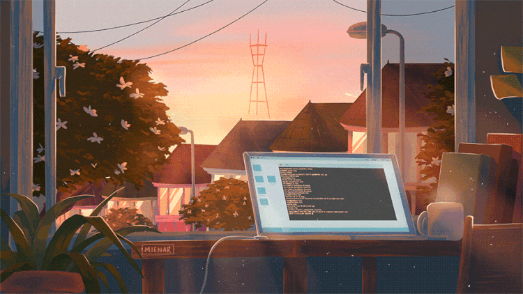

  

I'm a full-stack developer who enjoys turning ideas into working products — from the database schema to the last pixel of the UI. Right now my day-to-day is built around **React.js**, **Next.js**, **Node.js**, **Express.js**, **MongoDB**, and **PostgreSQL**, and I'm steadily sharpening those skills through real projects rather than tutorials alone.

I like understanding how a system fits together — how the frontend talks to the API, how the API talks to the database, and where things tend to break in between. Still learning, still building, and genuinely enjoying the process.

 

 &nbsp; 

 &nbsp; 

 &nbsp; 

 &nbsp; 

 &nbsp;  &nbsp; Flutter · React Native · Swift

 &nbsp; 

 &nbsp;  &nbsp; 

 

  

<i>Building. Learning. Improving. One project at a time.</i>

 

